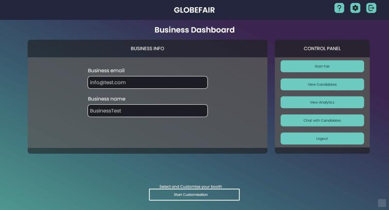
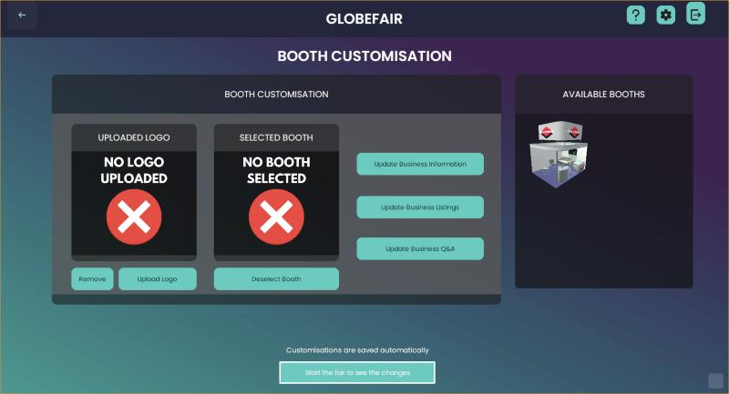
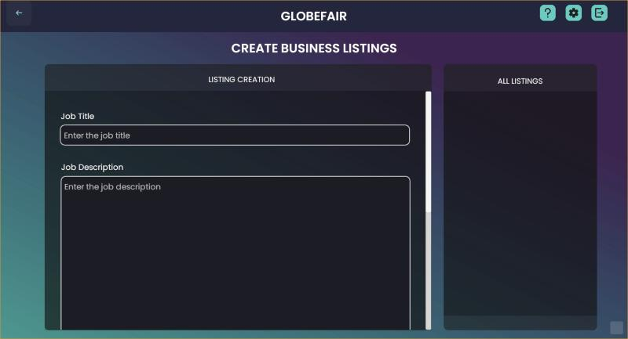
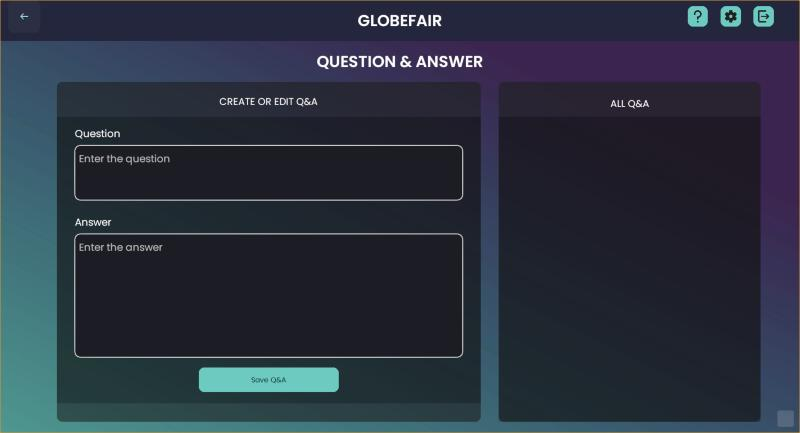
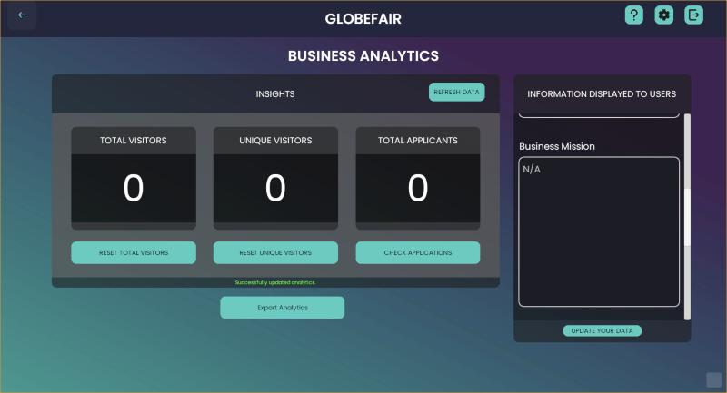
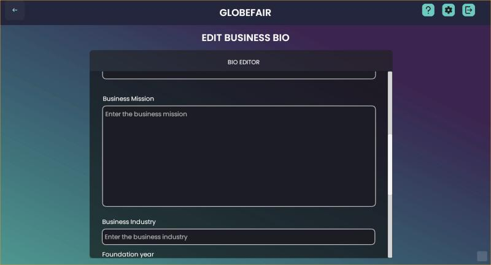
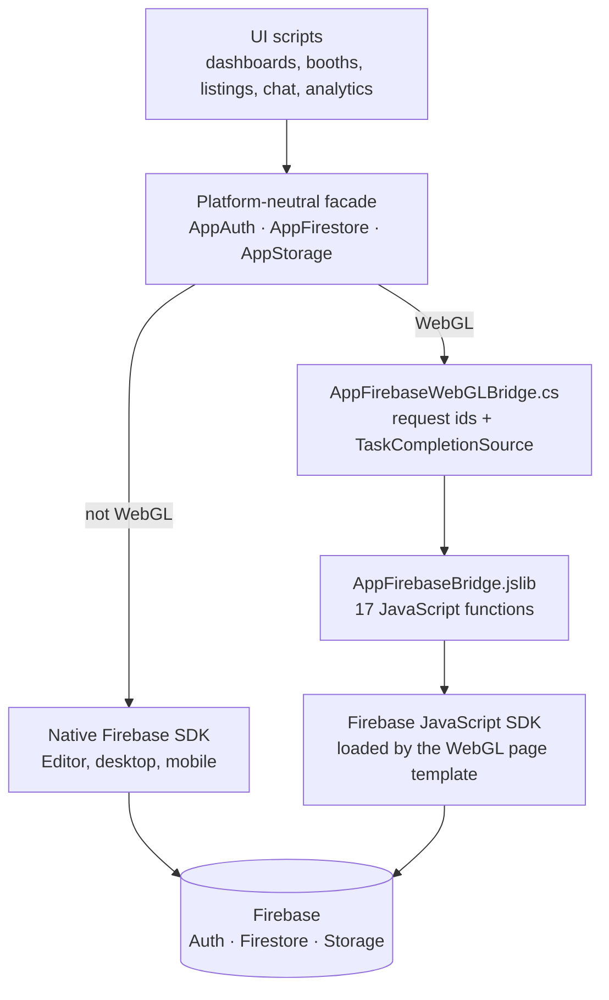

<h1 align="center">GlobeFair</h1>

<p align="center">
  <b>A 3D virtual career fair that runs in your browser.</b><br>
  Job seekers and businesses meet, apply, chat and recruit in one shared exhibition hall.
</p>

<p align="center">
  <a href="https://globefair-46eb2.web.app/">Live demo</a> (password on request) ·
  <a href="#features">Features</a> ·
  <a href="#architecture">Architecture</a> ·
  <a href="#installation-guide">Installation</a> ·
  <a href="#possible-issues">Possible issues</a>
</p>

<p align="center">
  
</p>

<p align="center">
  
</p>

## Project Description

GlobeFair began as my University of Leicester final-year project, a desktop virtual career fair ([original repository](https://github.com/youssefsadquy/globefair)). This repository is the web version, rebuilt to run in a browser with nothing to install.

The goals of the project:

1. Turn the traditional career fair into an online 3D experience people can explore.
2. Give businesses the tools to take part: a booth, job listings, a bio, Q&A, candidate lists, analytics and chat.
3. Give job seekers one place to upload a CV, apply and keep track of their applications.
4. Run the same Unity code on desktop and in the browser, which meant building a Firebase layer for WebGL, because Unity's official Firebase SDK does not support it.

It is a portfolio project. The source is shared so you can see how it is built and borrow ideas; it is not packaged as a product.

## Features

**For job seekers**
- Create an account, sign in and recover a forgotten password
- Upload a PDF CV from the dashboard
- Enter the 3D exhibition hall and explore it in a third-person view
- Apply to listings and track every application
- Chat with businesses

**For businesses**
- Separate business sign-up and dashboard
- Pick a booth from the ones still free, and set a profile with a logo and bio
- Create, edit and remove job listings
- See everyone who applied, with the listing and contact details
- Publish questions and answers for visitors
- View booth analytics: total visits, unique visitors and number of applicants
- Chat with candidates

**For everyone**
- Interface in English, Spanish, French and Italian
- Avatar customiser, context-sensitive tutorial cards, graphics quality, music volume and fullscreen options

## Screens

**Getting in**

| | |
|---|---|
| <br>Visitors choose business or private access | <br>Login with password recovery |
| <br>Business sign-up | <br>Context-sensitive tutorial cards |
| <br>Language, graphics quality, music volume and fullscreen | |

**Business tools**

| | |
|---|---|
| <br>Business dashboard: profile, fair entry, candidates, analytics and chat | <br>Booth customisation: logo upload and the booths still available |
| <br>Create and manage job listings | <br>Publish questions and answers for visitors |
| <br>Booth analytics: visitors, unique visitors and applicants | <br>Business bio shown to visitors |

## Architecture

The app is a set of Unity scenes (landing, dashboards, the fair) whose C# scripts talk to Firebase through one small layer of my own, so the same gameplay code runs on desktop and in the browser.



How one WebGL call works: a script awaits `AppFirestore` as it would on desktop. The facade hands the request to the bridge, which gives it an id and returns a pending task. JavaScript runs the real Firebase call in the browser and calls back into Unity with the result, which completes the task.

### Engineering notes

- **A Firebase layer for WebGL.** The facade (`Assets/Scripts/AppFirebase`, about 1,400 lines) exposes the same operations everywhere: sign-in and sign-up, password reset, auth state, document get, set, update, delete and add, collection queries, real-time document listeners, and storage upload, download URL and delete. On WebGL these map to 17 functions in `Assets/Plugins/WebGL/AppFirebaseBridge.jslib`.
- **Existing code kept working.** The facade types mirror the official ones: `AppUser` is value-equal on user id so existing "has the user changed" checks keep working, `AppTimestamp` round-trips through both SDKs, and `AppTaskExtensions` is a drop-in for Firebase's `ContinueWithOnMainThread`, which pulls in native code WebGL cannot use.
- **Arbitrary documents across the C# to JavaScript boundary.** `JsonUtility` needs a fixed schema, and Firestore documents have free-form fields, so `AppMiniJson` is a small dependency-free JSON reader and writer written for this bridge.
- **Making the build fit in a browser.** The first WebGL build had a data archive of about 1.4 GB and scenes failed to load. The editor tools under `Tools/WebGL` optimise textures and compress audio in bulk and report asset sizes, and `Tools/Performance` marks static geometry, adds distance-culled LODs, rebakes occlusion culling and tightens quality tiers. The deployed build is about 400 MB.
- **Two kinds of user.** Job seekers and businesses have separate sign-up flows and dashboards, with their data kept in separate Firestore collections.
- **Localisation at runtime.** The four languages are switched while the app is running, from localisation data, with no separate scenes.

About 7,000 lines of C# and 360 lines of JavaScript.

### Data model

| Collection | Holds |
|---|---|
| `users` | Job seeker profiles |
| `bus_users` | Business accounts and their selected booth |
| `booths` | Booths and whether each one is taken |
| `businessListings` | Job listings created by businesses |
| `candidates` | Applications, linking a job seeker to a listing |
| `businessQA` | Questions and answers published by a business |
| `feedback` | Feedback submitted from the app |

CVs and business logos are stored in Firebase Storage.

## Requirements

- [Unity Hub](https://unity.com/download) with **Unity 2021.3.26f1** and the **WebGL Build Support** module
- A [Firebase](https://firebase.google.com/) project with **Authentication** (email and password), **Cloud Firestore** and **Storage**
- [Node.js](https://nodejs.org/) and the [Firebase CLI](https://firebase.google.com/docs/cli) (`npm install -g firebase-tools`) to deploy

## Installation Guide

### Firebase setup

1. In the Firebase console, create a project and enable Authentication (email and password), Firestore and Storage.
2. Register a **Web app** in Project settings and copy its configuration.
3. Write security rules so users read and write only their own data and uploads are limited by size and type.

### Project setup

1. Clone the repository and add it in Unity Hub (it reads `Packages/manifest.json`).
2. Copy `Assets/WebGLTemplates/GlobeFair/firebase-config.example.js` to `firebase-config.js` in the same folder and fill in your Firebase values. The file is git-ignored.
3. Search the project for `globefair-46eb2` and replace it with your Firebase project ID. It appears in the storage bucket in `UserDashboardManager.cs` and in the hosting site in `firebase.json`.
4. The main fair scene, exhibition models and character assets are not in this repository, so add your own scene and models, or work with the included Landing and Customiser scenes.

## Running the Application

1. **In the Editor:** open the Landing scene and press Play. The Editor uses the native Firebase SDK, so add the Firebase Unity SDK to the project first.
2. **For the web:** open **File > Build Settings**, switch to WebGL, set **Player Settings > Resolution and Presentation > WebGL Template** to `GlobeFair`, and build into a folder called `WebGLBuild`.
3. **Deploy:** run `firebase login`, then `firebase deploy --only hosting`. To try a build first without touching the live site, use `firebase hosting:channel:deploy preview`.

## Possible Issues

**The page stays blank or the console says `firebase is not defined`**
- Check that `firebase-config.js` exists next to the template's `index.html` and that the `GlobeFair` WebGL template is the one selected in Player Settings.

**The build loads but scenes fail to open in the browser**
- The data archive is probably too large. Run `Tools > WebGL > 1. Optimize All Textures For WebGL` and `2. Compress All Audio For WebGL`, then `3. Report Asset Size Summary` to see what is still big.

**Sign-in works but uploads or reads fail**
- Check that you replaced every `globefair-46eb2` with your own project ID, and that your Firestore and Storage rules allow the signed-in user to read and write their own documents.

**A script is reported missing after importing the project**
- Run `Tools > Find Missing Scripts In Open Scenes`, then re-add any packages that are not in this repository.

## Repository layout

```
Assets/
  Scripts/              gameplay and UI logic (dashboards, booths, listings, chat, analytics, localisation)
  Scripts/AppFirebase/  the Firebase facade and WebGL bridge
  Plugins/WebGL/        JavaScript side of the bridge, and the browser download helper
  WebGLTemplates/       custom page template that loads the Firebase JavaScript SDK
  Editor/               build tools (WebGL optimisation, performance, missing-script finder)
  Customiser/           avatar customiser scene and scripts
  Scenes/               landing scene
Packages/               Unity package list
firebase.json           Firebase Hosting configuration
```

## Timeline

The web version was developed over about four weeks in August 2026 and deployed to Firebase Hosting in September 2026. This repository was published in October 2026: its commits group the existing code by feature and are not a record of when each part was written.

## License

MIT. See [`LICENSE`](LICENSE).
