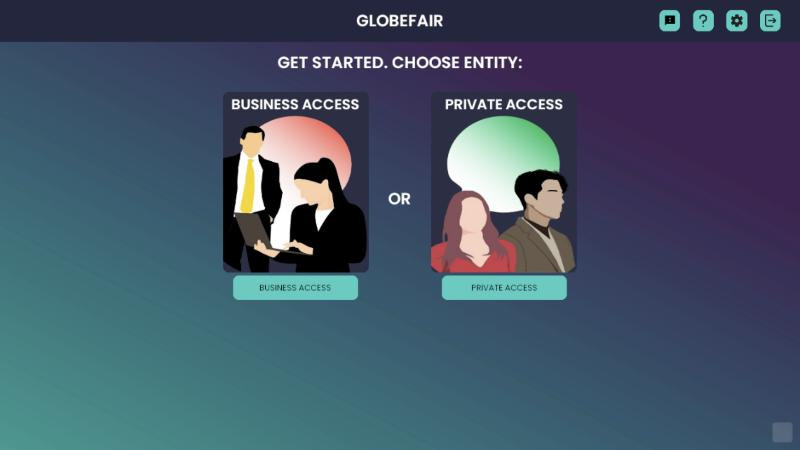
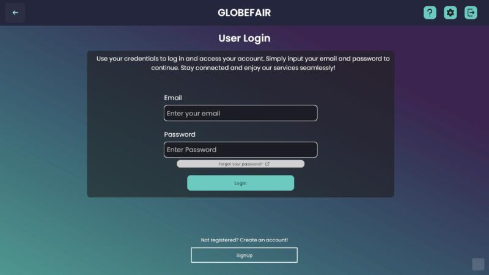
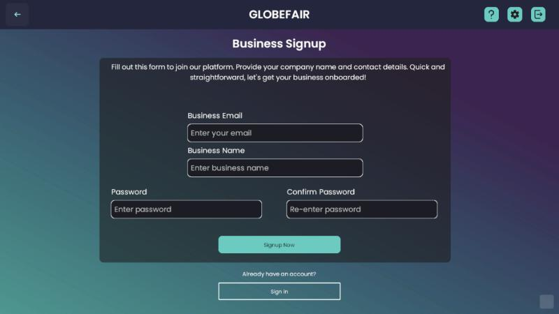
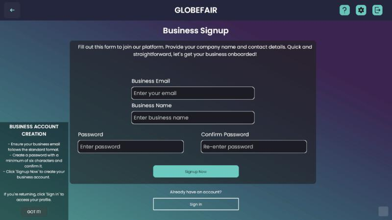
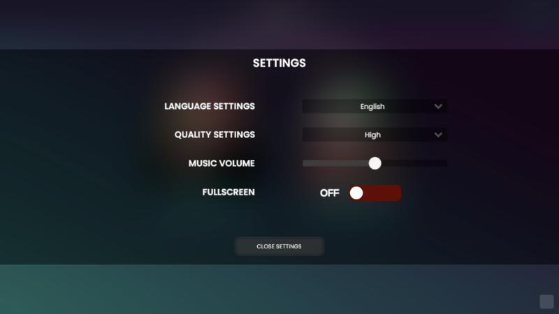
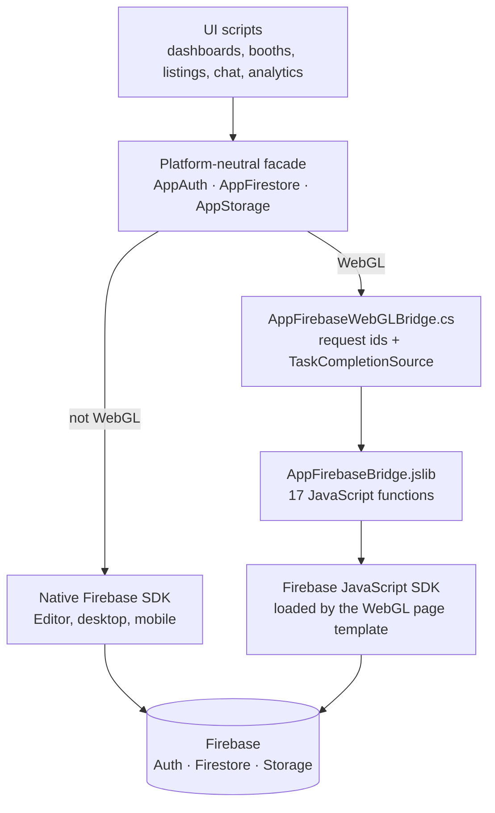

# GlobeFair

**A 3D virtual career fair that runs in the browser.** Job seekers and businesses sign up, meet in a shared exhibition hall, and handle the whole recruiting loop in one place: booths, job listings, applications, chat and analytics.

Unity 2021.3 LTS · C# · Firebase (Authentication, Firestore, Storage) · WebGL · Firebase Hosting



[Live demo](https://globefair-46eb2.web.app/) (password on request) · [Architecture](#architecture) · [Engineering notes](#engineering-notes) · [Data model](#data-model) · [Run your own copy](#run-your-own-copy)

## Why this project exists

GlobeFair began as my University of Leicester final-year project, a desktop virtual career fair ([original repository](https://github.com/youssefsadquy/globefair)). This repository is the web version: the same idea rebuilt to run in a browser with nothing to install, which meant solving a real engineering problem, because Unity's official Firebase SDK does not support WebGL.

It is a portfolio project. The source is shared so you can see how it is built and borrow ideas; it is not packaged as a product.

## Screens

| | |
|---|---|
| <br>**Entry:** visitors choose business or private access | <br>**Login** with password recovery |
| <br>**Business sign-up** | <br>**Context-sensitive tutorial** panels on every screen |
| <br>**Settings:** language, graphics quality, music volume, fullscreen | |

## What it does

**For job seekers**
- Create an account, sign in and recover a forgotten password
- Upload a PDF CV from the dashboard
- Enter the 3D exhibition hall and explore it in a third-person view
- Apply to listings and track every application
- Chat with businesses

**For businesses**
- Separate business sign-up and dashboard
- Pick a booth from the ones still free, and set a profile with a logo and bio
- Create, edit and remove job listings
- See everyone who applied, with the listing and contact details
- Publish questions and answers for visitors
- View booth analytics: total visits, unique visitors and number of applicants
- Chat with candidates

**For everyone**
- Interface in English, Spanish, French and Italian
- Avatar customiser, in-app tutorial panels, graphics quality and fullscreen options

## Architecture

The app is a set of Unity scenes (landing, dashboards, the fair) whose C# scripts talk to Firebase through one small layer of my own, so the same gameplay code runs on desktop and in the browser.



How one WebGL call works: a script awaits `AppFirestore` as it would on desktop. The facade hands the request to the bridge, which gives it an id and returns a pending task. JavaScript runs the real Firebase call in the browser and calls back into Unity with the result, which completes the task.

## Engineering notes

- **A Firebase layer for WebGL.** The facade (`Assets/Scripts/AppFirebase`, about 1,400 lines) exposes the same operations everywhere: sign-in and sign-up, password reset, auth state, document get, set, update, delete and add, collection queries, real-time document listeners, and storage upload, download URL and delete. On WebGL these map to 17 functions in `Assets/Plugins/WebGL/AppFirebaseBridge.jslib`.
- **Existing code kept working.** The facade types mirror the official ones: `AppUser` is value-equal on user id so existing "has the user changed" checks keep working, `AppTimestamp` round-trips through both SDKs, and `AppTaskExtensions` is a drop-in for Firebase's `ContinueWithOnMainThread`, which pulls in native code WebGL cannot use.
- **Arbitrary documents across the C# to JavaScript boundary.** `JsonUtility` needs a fixed schema, and Firestore documents have free-form fields, so `AppMiniJson` is a small dependency-free JSON reader and writer written for this bridge.
- **Making the build fit in a browser.** The first WebGL build had a data archive of about 1.4 GB and scenes failed to load. `Assets/Editor/OptimizeForWebGL.cs` applies browser-appropriate texture import overrides in bulk, and the deployed build is about 400 MB.
- **Two kinds of user.** Job seekers and businesses have separate sign-up flows and dashboards, with their data kept in separate Firestore collections.
- **Localisation at runtime.** The four languages are switched while the app is running, from localisation data, with no separate scenes.

About 7,000 lines of C# and 360 lines of JavaScript.

## Data model

| Collection | Holds |
|---|---|
| `users` | Job seeker profiles |
| `bus_users` | Business accounts and their selected booth |
| `booths` | Booths and whether each one is taken |
| `businessListings` | Job listings created by businesses |
| `candidates` | Applications, linking a job seeker to a listing |
| `businessQA` | Questions and answers published by a business |
| `feedback` | Feedback submitted from the app |

CVs and business logos are stored in Firebase Storage.

## Repository layout

```
Assets/
  Scripts/              gameplay and UI logic (dashboards, booths, listings, chat, analytics, localisation)
  Scripts/AppFirebase/  the Firebase facade and WebGL bridge
  Plugins/WebGL/        JavaScript side of the bridge, and the browser download helper
  WebGLTemplates/       custom page template that loads the Firebase JavaScript SDK
  Editor/               build tools (WebGL texture overrides, missing-script finder)
  Customiser/           avatar customiser scene and scripts
  Scenes/               landing scene
Packages/               Unity package list
firebase.json           Firebase Hosting configuration
```

Large third-party content (the exhibition models, character system, audio) and the main fair scene are not included, so the project will not open complete from this repository alone.

## Run your own copy

1. Install Unity 2021.3.26f1 and open the project.
2. Create a Firebase project with Authentication (email and password), Firestore and Storage, and register a Web app.
3. Copy `Assets/WebGLTemplates/GlobeFair/firebase-config.example.js` to `firebase-config.js` in the same folder (it is git-ignored) and fill in your values.
4. Search for `globefair-46eb2` and replace it with your project ID (the storage bucket in `UserDashboardManager.cs`, the hosting site in `firebase.json`).
5. Build for WebGL with the `GlobeFair` template, then `firebase deploy --only hosting`.

## Securing a public Firebase demo

A Firebase web API key is public by design, because the browser needs it. A public demo is protected by restricting the key to your domains and the APIs you use, turning on App Check for Firestore and Storage, and writing security rules so users read and write only their own data and uploads are limited by size and type.

## Timeline

The web version was developed over about four weeks in August 2026 and deployed to Firebase Hosting in September 2026. This repository was published in October 2026: its commits group the existing code by feature and are not a record of when each part was written.

## Licence

MIT for the original code in this repository (see `LICENSE`).
